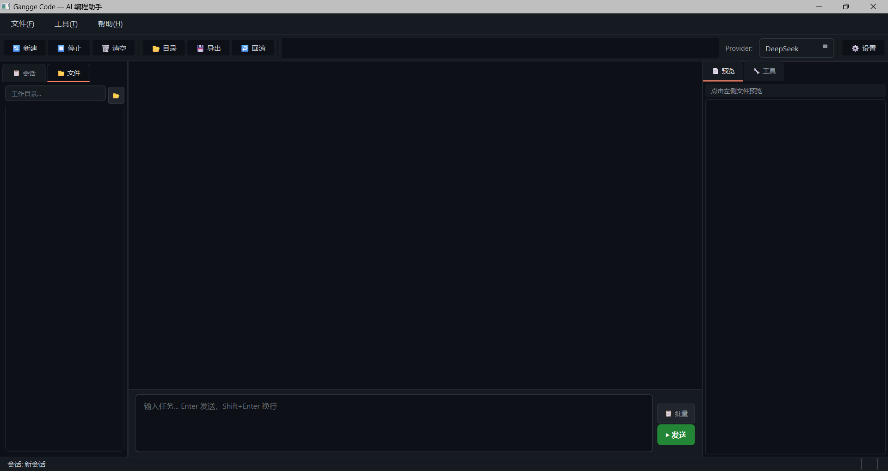

<div align="center">

# ⚡ Gangge Code

**会写小说的 AI 编程助手 —— 一句话写一章，一段文案出一条片**

<p align="center">
  
  
  
</p>

📖 小说引擎 · 🎬 视频出片 · 🤝 任务外包 · 💻 编程助手

[English](./README_EN.md) | 中文

</div>

---



## 五件事，都是「给一句话，出一份成品」

| 你给 | 它出 | 怎么做到的 |
|---|---|---|
| 「把第三章写出来」 | 一章正文 + 审计报告 | 五层流水线：规划 → 撰写 → 校验 → 审计 → 修订，自动跑完 |
| 一段口播稿 | 带配音、字幕的 mp4 | 五种视觉风格 + 竖屏 + 3D 展示页 + 人物纪录片，技能里点一下就开始 |
| 一个网址 | 3D 展示页 / 网站展示视频 | 整页截图装进浏览器框，滚一下镜头就往前推 |
| 一张零件图纸 | .blend + .glb + 多角度渲染图 | 内置 Blender 工具，按尺寸写 bpy 代码增量建模，装好 Blender 即可用 |
| 一块能验证的活 | 结论 + 验收结果 + 日志 | 外包给 Qoder 独立进程，主对话只收一段结论 |

这五件事在同一个桌面应用里，共用一套工具、权限和回滚机制——不是五个脚本书钉在一起。

## 🚀 三分钟跑起来

```bash
git clone https://github.com/ydsgangge-ux/novels-code.git
cd gangge-code

pip install -e ".[gui]"          # 桌面端（推荐）
# 要视频出片就换成：pip install -e ".[gui,video]"（playwright + edge-tts）
playwright install chromium      # 只有 page=site 抓网页截图时才需要

cp .env.example .env             # 填一个 API Key 即可
```

```ini
LLM_PROVIDER=deepseek
DEEPSEEK_API_KEY=sk-xxx
```

```bash
python desktop/app.py                        # 桌面端
gangge "创建一个带用户认证的 FastAPI 项目"     # 单次任务
gangge                                       # 交互式 REPL
```

不想给任何 API Key 也能跑：`LLM_PROVIDER=ollama` 指向本机模型。

## 📖 写小说：从设定一路写到导出

内置 **Dramatica-Flow**，一句话就能推进，不用记命令：

```
你：加一个和主角从小一起长大的朋友，性格要怂但关键时刻靠谱
AI：✓ 已写入角色档案（第 7 号角色 · 关系：发小）
你：第三章太平了，加点悬念
AI：✓ 已调整第三章大纲：埋 2 处伏笔，结尾留钩子
你：写下一章
AI：▶ Architect 规划 → Writer 撰写 → 审计 2 处逻辑问题 → 修订 → 完成
```

**五层流水线**（每章都走一遍，不满意可以只重跑某一层）：

1. **Architect** — 读大纲、世界观、前文摘要，产出本章蓝图
2. **Writer** — 按蓝图写正文，保持文风与人物口吻一致
3. **写后校验** — 抽因果链、生成摘要、更新世界状态
4. **Auditor** — 查逻辑漏洞、伏笔是否收、人物行为是否合理
5. **Reviser** — 按审计意见改，循环到过审

**16 个专用工具**：`novel_init` 建书 · `novel_setup` 设定 · `novel_outline` 大纲 ·
`novel_chapter_outlines` 拆章 · `novel_write_chapter` 写章 · `novel_audit` 审计 ·
`novel_revise` 修订 · `novel_edit` 改任何元素（角色/关系/伏笔/大纲/正文）· `novel_status` 进度 ·
`novel_import` 导入 · `novel_export` 导出 TXT/EPUB · `novel_consistency_check` 全书一致性 ·
`novel_graph_query` / `novel_graph_rebuild` 叙事图谱 · `novel_navigate` 跳转 · `novel_list_books` 书单

**仿写**：导入几十万字的 TXT，多段采样分析文风、全文抽取人物、拆情节弧线与情绪曲线，
写作时按进度动态对齐参考文本——长篇会自动分块，不会一上来就撑爆上下文。

**叙事图谱**：人物、事件、关系存成图，因果链和伏笔是否闭环可查询，续写不靠猜。

**专业面板**：仪表盘 / 角色 / 大纲 / 章节 / 世界观 / 追踪 / 词库。

## 🎬 视频一键输出

一段文案进去，一条带配音和字幕的 mp4 出来。`page` 决定拍哪张页面：

| page | 页面 | 适合 |
|---|---|---|
| `storyboard` | 朴素分镜页（默认） | 最快最轻，纯信息 |
| `showcase` | 3D 展示页：分镜装进浏览器框，滚动即推镜头 | 产品 / 项目介绍 |
| `site` | 3D 展示页 + 真实网站整页截图当内页 | 介绍自己的站点（给 `url`） |
| `person` | 人物光线纪录片：光路穿过一生的每个节点 | 人物生平、传记、纪念片（照片可选） |


`person` 是**连续镜头**而不是切镜：光点沿线走，停在一个年份上讲一段，讲完继续走。
分镜里第一个 `title` 是开场名牌、最后一个 `outro` 是结语，中间每个镜头就是一个人生节点
（`year` / `title` / `text`）。照片给不给都行——给一个目录就按文件名轮着发到各节点，
不给就画占位框，照样出片。

桌面端「⚡ 技能 → 视频出片」里有 11 条现成入口（五种风格 + 自动选风格 + 竖屏 +
3D 展示页 + 网站展示 + 人物纪录片 + 样式工作台），点一下就把提示词填好，不用记参数。

人物纪录片是个例外：点它不会往输入框里塞提示词，而是把右侧翻到「✍ 填写」页——
一张表填人名、副标题、结语和一串人生节点（年份/标题/正文/照片，随手增删排序），
点「▶ 预览这一版」直接在浏览器里看，内容自动存草稿。要出片再用下面这条命令。

命令行等价写法：

```bash
# 现成文案 → 分镜 → 配音 → 成片
python -m gangge.layer4_tools.storyboard -c 口播稿.txt --page showcase --style neon

# 一个网址 → 整页截图 → 3D 展示视频
python -m gangge.layer4_tools.storyboard -c 口播稿.txt --page site -u https://example.com

# 一个人 + 一段生平 → 光线纪录片（照片可给可不给）
# 现成示例：examples/person.json
python -m gangge.layer4_tools.storyboard -f examples/person.json --page person --photos 照片目录

# 只想先看页面，不渲染视频
python -m gangge.layer4_tools.storyboard -s --page showcase --preview
```

页面是**模板文件**（`storyboard/pages/*.html`），改版式直接改 HTML，不用碰 Python；
新增一种页面只需放文件 + 在 `pages.py` 的 `TEMPLATES` 里登记一行。

> 抓网页截图一直超时，但 `curl --resolve 域名:443:IP` 能通？那是 DNS 被污染。
> 加 `--resolve github.com=140.82.112.4` 让浏览器绕过解析即可。

**不确定该用哪套？打开样式工作台**

三种打开方式，挑顺手的：

- 桌面端：「⚡ 技能」菜单最下面一项 **🎛 样式工作台**，点了当场生成并在浏览器打开
- 双击仓库根目录的 `打开样式工作台.bat`
- 命令行：`python -m gangge.layer4_tools.storyboard.studio`

```bash
# 产物是单文件，约 270 KB，双击就能开，断网也能用
.gangge/style-studio.html
```

风格、装饰、画幅、帧率是**四个独立旋钮**，不是固定套餐：5 种风格 × 2^5 层装饰 × 2 画幅
= 320 种组合，随手切随手看，时间轴还能拖到任意一帧。底部同时给出三份可直接用的配置——
JSON、命令行、`demo_video(...)` 调用。

内部实现只有 10 份预渲染页面（5 风格 × 2 画幅），装饰层全部生成、前端按勾选显隐，
所以体积 270 KB 而不是几十 MB。

## 🧊 3D 建模：图纸进去，模型出来

内置 `blender` 工具，**不需要装 MCP、不需要写任何配置文件**。本机装了 Blender 就自动启用。

```bash
# 装在默认位置时什么都不用配；认不出来就用环境变量指一下
export BLENDER_PATH=/Applications/Blender.app/Contents/MacOS/Blender   # macOS
set BLENDER_PATH=D:\Program Files\Blender Foundation\Blender 5.2\blender.exe   # Windows
```

```text
你：按这张图纸建一个 KCD4-30A 船型开关，法兰 32×25，主体 29×19.4×20
它：建法兰 → 挖内孔 → 拉主体 → 加卡扣 → 做翘板 → 排 6 个端子 → 渲染出图
```

模型存在 `.gangge/blender/workspace.blend`，可以一轮一轮接着改，不用每次重建。

| action | 用途 |
|---|---|
| `execute` | 执行任意 bpy 代码（最常用） |
| `scene_info` | 列出场景对象、尺寸、材质 |
| `object_info` | 单个对象的详细信息 |
| `render` | 渲染成 PNG |
| `reset` | 清空场景重来 |

两个真机上踩过的坑，工具里已经处理掉了：

- **中文版 Blender 会把节点名本地化成「原理化 BSDF」**，`nodes.get("Principled BSDF")` 会拿到 `None` 然后报 `AttributeError`。工具注入了 `new_material()` 和 `bsdf_of()`，按 `node.type` 查找，中英文界面都稳。
- **场景没有相机和灯光时渲染出来是全黑**。`render` 会按包围盒自动取景，没灯就补三盏太阳光。

## 🤝 把活外包给 Qoder

有些活又长又机械：改十几个文件、重命名、补一批测试、升级依赖后跑全量验证。
这类任务最耗上下文——读的每一行都留在主对话里，最后只为了一个「改完了」。

`qoder_delegate` 把它丢给 Qoder CLI 的**独立进程**，主对话只收一段结论：

```
你：把项目里 old_name 批量改成 new_name，范围限 src/
AI：▶ 委派中（scope: src/**　dod: pytest -q）
    ✓ status=done | 改动 14 个文件 | 全量测试通过 | 日志 .gangge/qoder/xxx.log
    结论：命名已统一，另有 2 处文档未在 scope 内，需要你确认是否一起改。
```

三条硬规矩，让「外包」不等于「失控」：

| 规矩 | 作用 |
|---|---|
| `scope` 必填 | 允许改的文件白名单（支持 glob），越界会被判定 `violated` |
| `dod` 必填 | 完成定义是一组**机器能判定**的验收命令，不绿不算完 |
| 结论有上限 | 回传摘要 ≤1400 字符 + 验收结果 + 日志路径，探索过程留在对面 |

`status` 四态：`done` 全绿 / `partial` 改了但没全绿（须自己看 checks）/ `violated` 改到白名单外（该回滚）/ `failed`。

**超时按「沉默」算，不按总时长。** 连续 10 分钟没有任何输出才判死，只要它还在干活就一直跑
（`QODER_IDLE_TIMEOUT_S` 可调）；总时长上限默认不限，确实想设天花板时给 `timeout_s`。
终止会连进程树一起杀掉（node 子进程不会残留），但**已改的文件留在工作区**，需要自己核对：

```bash
git diff --stat    # 超时后先看清它改到哪一步
```

前置：本机装好 Qoder CLI（CN 版 `qoderclicn`、国际版 `qodercli`），程序会自动在 PATH 和常见安装目录里找。

## 💻 编程助手

同一个引擎，去掉小说和视频就是一个能自己干活、也会自己收手的编程助手。

```
你：帮我创建一个 FastAPI 项目，带用户注册登录功能
AI：📋 任务清单 (0/4) → 建结构 → User 模型 → 注册/登录 API → JWT 中间件
    ✓ 已创建 app/models/user.py (42 行)
    ✓ 已创建 app/routes/auth.py (83 行)
    ✓ pytest 全部通过
```

按场景自动切 Profile，只暴露相关工具，不让模型在 25 个工具里瞎挑：

| Profile | 工具数 | 触发场景 |
|---|---|---|
| **Coding** | 13 个 | 创建 / 修改 / 实现 / 修复 / 构建 |
| **Novel** | 25 个 | 小说 / 写作 / 章节 / 角色 / 大纲 |
| **Research** | 10 个 | 搜索 / 查找 / 调研 / 联网 |

几个真正省事的设计：

- **改前打检查点**：Shadow Git 自动存档，改坏了 `git revert` 一条命令回去
- **写完自检**：LSP 跑 pyright/ruff，语法错误当场修，不等到你发现
- **只读就收手**：连续 3 轮只看不改 → 自动结束，不空转烧钱
- **会自己造工具**：`create_tool` 在运行时新建工具，存进 `.gangge/plugins/`，下次自动加载
- **能接 MCP**：stdio / SSE 两种传输，`.gangge/mcp_servers.json` 里的服务自动注册成工具
- **联网搜索可升级**：填一个 DeepSeek Key，`web_search` 换成官方 Search（带摘要、发布时间、权威分），
  `web_fetch` 换成官方 Fetch（直接给 Markdown）；没填就自动退回 DuckDuckGo / Bing，不影响使用。
  Key 独立于主模型，桌面端「设置 → 联网搜索」填一次即可（主模型是 DeepSeek 时无需填，自动复用）
- **跨会话记忆**：Memory Bank 记进度和踩过的坑；`.ganggerules` 定项目规范

## ⚙️ 配置

```ini
LLM_PROVIDER=deepseek          # deepseek / openai / anthropic / ollama
DEEPSEEK_API_KEY=sk-xxx
MAX_ROUNDS=30                  # 最大工具调用轮数
LLM_TIMEOUT=300                # LLM 响应超时（秒）
```

架构与扩展点（运行时组合、护栏、请求级 hook）见 [`docs/architecture.md`](docs/architecture.md)。

## 🗺️ Roadmap

- [x] Agentic Loop + TodoWrite 自动状态管理
- [x] Agent Profile 场景化工具动态暴露
- [x] Shadow Git Checkpoint / 回滚
- [x] LSP 语法检查（pyright / ruff / pylint）
- [x] Memory Bank + Decision Log
- [x] AI 自建工具 + 插件系统
- [x] MCP 协议支持（stdio + SSE）
- [x] Dramatica-Flow 小说创作引擎
- [x] 视频出片（五种风格 / 竖屏 / 3D 展示页 / 网站展示 / 人物纪录片）
- [x] Qoder 委派（scope + dod + 四态结果）
- [x] PyQt6 桌面 GUI
- [ ] Web UI（远程访问）
- [ ] 向量索引（RAG）局部上下文
- [ ] 协作模式（多人共享会话）

## 📜 License

MIT © [ydsgangge-ux](https://github.com/ydsgangge-ux)
